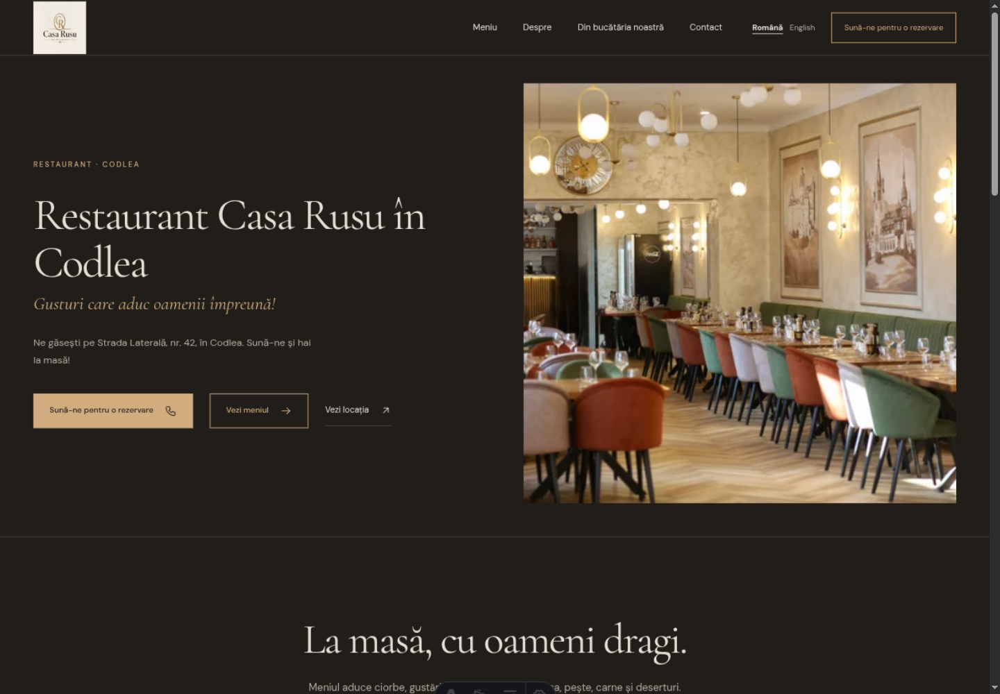

# Identità digitale · 22 ottobre 2026

La testata e il footer usano una nuova interpretazione digitale del marchio: monogramma CR nell’ovale in SVG, nome in Cormorant Garamond 500 e descrittore Restaurant in DM Sans. Non è un vettoriale ufficiale fornito dal ristorante. Il JPG originale resta invariato, anche come immagine del marchio nei dati strutturati.

## Problema e scelta

Il JPG da 720×720 veniva ridotto a 76×76 nella testata: margini e texture occupavano gran parte dello spazio, con lettere e decorazioni minuscole. `mix-blend-mode: multiply` mascherava il fondo in chiaro, mentre in scuro rimaneva il quadrato color carta.

La nuova composizione orizzontale separa simbolo, nome e descrittore. Il monogramma riprende le iniziali intrecciate e l’ovale, semplificando sfumature e decorazioni; il nome usa il font locale già presente nel sito. Nessun filtro, fusione o sfondo raster. I colori seguono i token del tema: testo bruno e bronzo in chiaro, avorio e oro tenue in scuro.

Il simbolo misura 34×51 px su desktop, 29×44 su mobile e 28×42 nella navigazione tablet. Il nome misura rispettivamente 34,4 / 32 / 28,8 px. La testata offre almeno 10 px di spazio verticale intorno al simbolo e separa la navigazione dal marchio. Queste sono scelte specifiche per questo layout, non misure universali ricavate dalle fonti.

Il link ha un nome accessibile localizzato che identifica il ristorante e la homepage. Il disegno e le scritte visive non vengono annunciati una seconda volta. La favicon usa gli stessi tracciati, senza dipendere dai font, e adatta il colore alle preferenze di sistema.

## Ricerca e applicazione

- [Nielsen Norman Group — Dark Mode: How Users Think About It and Issues to Avoid](https://www.nngroup.com/articles/dark-mode-users-issues/): lettere sottili e contrasto insufficiente compromettono i loghi in scuro. Qui si usano colori espliciti per ciascun tema e un nome più grande, senza appoggiarsi alla texture del JPG.
- [Atlassian Design — Logos](https://atlassian.design/foundations/logos): distingue simbolo, nome e testo secondario, con varianti di composizione. Qui questi elementi hanno proporzioni autonome adatte alla navigazione.
- [Atlassian Design — Logo component](https://atlassian.design/components/logo/code): il componente gestisce combinazioni cromatiche e temi. Qui SVG e testo ereditano i token semantici già presenti.
- [Mozilla — Trademark Guidelines](https://www.mozilla.org/en-US/foundation/trademarks/policy/): indica l’importanza dello spazio intorno al marchio. Il principio viene applicato alla testata, senza trasferire regole o misure di Mozilla a Casa Rusu.
- [W3C WAI — Functional Images](https://www.w3.org/WAI/tutorials/images/functional/): un logo che porta alla homepage deve comunicare la destinazione; gli elementi ridondanti vanno evitati nella lettura assistita. I loghi sono esenti da alcuni requisiti di contrasto e dimensione del testo: il contrasto è comunque un obiettivo di leggibilità del progetto.

## Anteprime

| Prima, tema scuro | Dopo, tema scuro |
| --- | --- |
|  |  |

[Desktop chiaro](after-desktop-light.png) · [Mobile chiaro](after-mobile-light.png) · [Mobile scuro](after-mobile-dark.png)

Le schermate sono catturate nel browser Paseo locale. Il tema scuro è quello di sistema; per il chiaro è stata applicata temporaneamente nel browser la stessa palette chiara del sito. Nessuna preferenza globale dell’utente è stata modificata.

## Verifica

- Controllo visivo desktop a 1440 e 768 px, mobile a 390 e 320 px; entrambe le palette a 1440 e 390 px. Nessuna sovrapposizione tra marchio e navigazione, nessuno scorrimento orizzontale ai viewport controllati (incluso 1024 px).
- Tutte e sei le rotte RO/EN controllate nel browser; link del marchio e nomi accessibili coerenti con la lingua. Menu mobile aperto e chiuso con Escape, con ritorno del focus al pulsante; footer controllato a 320 px.
- Contrasto calcolato sui colori sRGB: nome/sfondo 12,96:1 in chiaro e 12,55:1 in scuro; bronzo/sfondo 5,71:1 e oro/sfondo 7,84:1. Sono rapporti nominali dei colori, non misurazioni dei singoli pixel antialias.
- `npm run build` e `git diff --check` superati; Astro senza errori o avvisi, verifiche SEO, menu e orari superate.
